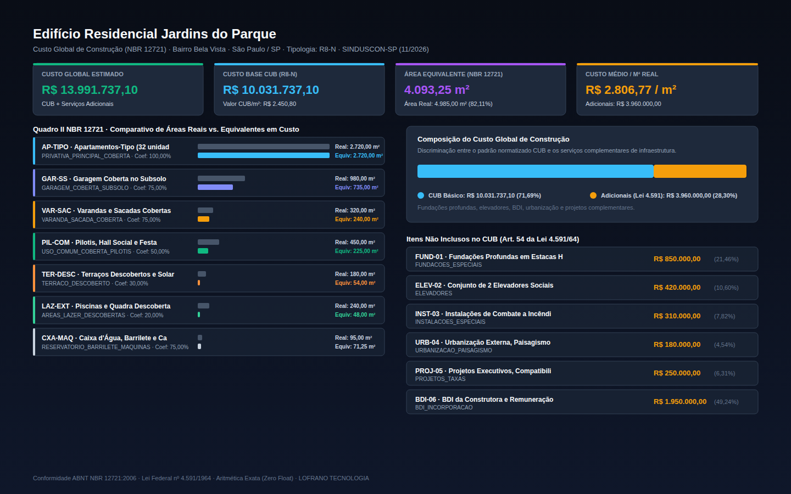

# Orçamento de Construção Civil — CUB e Área Equivalente (NBR 12721)

[](https://github.com/martinlofranodeoliveira/cub-construcao-civil-nbr12721/actions)
[](https://www.python.org/)
[](LICENSE)
[-success.svg)](pyproject.toml)
[-green.svg)](src/cub_construcao_civil/calculator.py)
[](tools/verify_independent.py)

Motor determinístico, auditável e matematicamente exato para cálculo de **Área Equivalente de Construção** e **Orçamento Global de Obra** baseado no **CUB (Custo Unitário Básico)** segundo a norma brasileira **ABNT NBR 12721:2006** e a **Lei Federal 4.591/1964** (Lei dos Condomínios e Incorporações Imobiliárias).

Desenvolvido segundo o padrão de engenharia e confiabilidade da **LOFRANO TECNOLOGIA**, este pacote opera com **zero dependências externas** (estritamente biblioteca padrão do Python) e **zero números em ponto flutuante** (`float`), utilizando representação em números inteiros (centésimos de metro quadrado e centavos de real) combinada com frações racionais exatas (`fractions.Fraction`).

---

## 📸 Painel Executivo de Orçamento de Obra

O motor gera automaticamente relatórios vetoriais em SVG (1440x900) e capturas em alta resolução com a discriminação das áreas reais e equivalentes, custos base CUB, itens adicionais previstos na Lei 4.591/64 e custos médios por metro quadrado:



---

## 🎯 Por Que Este Projeto Existe?

Na incorporação imobiliária e na construção civil brasileira, a determinação do custo global de uma edificação para fins de registro em cartório (Quadro IV da NBR 12721) e viabilidade econômico-financeira é regida pela **Lei 4.591/64** e pela **ABNT NBR 12721**. No entanto, sistemas legados e planilhas eletrônicas frequentemente incorrem em falhas graves:

1. **A Armadilha da Área Real vs. Área Equivalente**: Um metro quadrado de garagem no subsolo ou de solarium descoberto não custa o mesmo que um metro quadrado de apartamento de alto padrão com acabamentos nobres. A NBR 12721 estabelece a conversão de cada compartimento em **área equivalente em custo à área de padrão da edificação**. Somar áreas reais como base de custo direto gera distorções orçamentárias severas.
2. **O Que o CUB Cobre e Não Cobre (Lei 4.591/64)**: O CUB divulgado mensalmente pelos sindicatos da construção civil (SINDUSCON) cobre exclusivamente os custos do projeto-padrão (materiais e mão de obra diretos). O custo global da obra obrigatoriamente exige a inclusão fundamentada de itens não cobertos: fundações especiais, subestações e geradores, elevadores, ar-condicionado central, projetos executivos, taxas de licenciamento e o BDI (Benefício e Despesas Indiretas) da construtora/incorporadora.
3. **Discrepâncias por Arredondamento Flutuante (`float`)**: Cálculos de incorporação com centenas de unidades autônomas somando números `float` acumulam centavos perdidos que impedem a averbação no Cartório de Registro de Imóveis (onde o somatório das frações ideais e cotas deve fechar exatamente em $100\%$).
4. **Falta de Padronização e Auditabilidade**: Projetistas frequentemente utilizam fórmulas ad-hoc. Este motor oferece uma especificação JSON canônica, validação estrita de integridade e auditoria independente via SQLite.

---

## 📐 Fundamentação Normativa (ABNT NBR 12721)

### 1. Cálculo da Área Equivalente em Custo
Para cada compartimento $i$ da edificação com área real $A_{real, i}$ e coeficiente de equivalência $C_i = \frac{p_i}{q_i} \in \mathbb{Q}$:

$$A_{equiv, i} = \left\lceil \frac{A_{real, i} \cdot p_i}{q_i} \right\rceil$$

A área equivalente total é a soma de todos os compartimentos:

$$A_{equiv, total} = \sum_{i=1}^{n} A_{equiv, i}$$

O fator global de equivalência do empreendimento é a razão:

$$F_{global} = \frac{A_{equiv, total}}{A_{real, total}}$$

### 2. Tabela de Coeficientes de Equivalência Típicos (NBR 12721)

| Tipo de Divisão / Compartimento | Código Canônico | Coeficiente Padrão | Fração Exata | Justificativa Técnica |
|---|---|:---:|:---:|---|
| **Área Privativa Principal Coberta** | `PRIV_PRINCIPAL_COBERTA` | $100\%$ | $1/1$ | Unidade residencial ou comercial de referência. |
| **Garagem Coberta no Subsolo** | `GARAGEM_SUBSOLO` | $75\%$ | $3/4$ | Estrutura de contenção e ventilação sem acabamentos nobres. |
| **Garagem Coberta no Pavimento Térreo** | `GARAGEM_TERREO` | $50\%$ | $1/2$ | Estrutura convencional de piso e cobertura. |
| **Estacionamento / Garagem Descoberta** | `GARAGEM_DESCOBERTA` | $12{,}5\%$ | $1/8$ | Pavimentação asfáltica ou intertravada com drenagem. |
| **Varandas e Sacadas Cobertas** | `VARANDA_SACADA_COBERTA` | $75\%$ | $3/4$ | Alvenarias parciais, guarda-corpos e impermeabilização. |
| **Terraços Abertos e Solarium** | `TERRACO_ABERTO_DESCOBERTO` | $30\%$ | $3/10$ | Impermeabilização e pisos resistentes a intempéries. |
| **Pilotis e Pavimento de Lazer Coberto** | `PILOTIS_LAZER_COBERTO` | $50\%$ | $1/2$ | Estrutura aparente com áreas de circulação comum. |
| **Áreas de Lazer Externas Descobertas** | `LAZER_EXTERNO_DESCOBERTO` | $20\%$ | $1/5$ | Piscinas, quadras e paisagismo inicial. |
| **Caixa d'Água e Casa de Máquinas** | `BARRILETE_CASA_MAQUINAS` | $75\%$ | $3/4$ | Sobrecargas hidrostáticas e alvenarias técnicas. |

*Nota: O motor suporta coeficientes customizados expressos por frações racionais irredutíveis (`num`/`den`) caso o projetista justifique no memorial descritivo.*

### 3. Custo Global de Construção (NBR 12721 / Lei 4.591)

$$Custo_{BaseCUB} = \left\lceil \frac{A_{equiv, total} \cdot CUB_{m^2}}{100} \right\rceil$$

$$Custo_{Global} = Custo_{BaseCUB} + \sum_{k=1}^{m} Custo_{Adicional, k}$$

Onde os itens adicionais previstos na Lei 4.591/64 incluem:
- `FUNDACOES_ESPECIAIS`: Estacas profundas, tubulões pressurizados, tirantes de contenção.
- `ELEVADORES`: Instalação de equipamentos de transporte vertical.
- `AR_CONDICIONADO_CENTRAL`: Sistemas VRF, chillers e dutos de climatização.
- `SUBESTACAO_GERADOR`: Transformadores de média tensão e grupos motogeradores.
- `PROJETOS_LICENCIAMENTO`: Honorários de projetos executivos, outorga onerosa, taxas municipais.
- `BDI_INCORPORACAO`: Margem de risco, despesas gerais e remuneração da construtora.

---

## 🛡️ Padrão de Engenharia e Integridade LOFRANO TECNOLOGIA

- **Zero Float**: Nenhuma operação utiliza `float`. Áreas são armazenadas em centésimos de $m^2$ ($1{,}00\,\text{m}^2 = 100$), quantias monetárias em centavos de real ($R\$\,1{,}00 = 100$) e divisões utilizam a função de teto inteira `divisao_teto(n, d) = (n + d - 1) // d`.
- **Zero Dependências**: Executável em qualquer ambiente Linux, Windows ou macOS com Python 3.11+ instalado, sem necessidade de `pip install` de pacotes externos.
- **Codec JSON Canônico e Seguro**: Rejeita Byte Order Mark (BOM), números float na desserialização, chaves duplicadas e aninhamentos recursivos superiores a 32 níveis.
- **Proteção Contra Injeção de Fórmulas CSV**: Todas as células de texto em exportações CSV sofrem neutralização de caracteres de comando de planilhas (`=`, `+`, `-`, `@`, `\t`, `\r`).
- **Verificador Independente em SQLite (`tools/verify_independent.py`)**: Script autônomo que carrega o projeto em memória em tabelas relacionais do SQLite e recalcula todas as grandezas sem importar os módulos de produção.

---

## 🚀 Instalação e Execução

### Instalação Local
```bash
git clone https://github.com/martinlofranodeoliveira/cub-construcao-civil-nbr12721.git
cd cub-construcao-civil-nbr12721
python3 -m pip install .
```

### Comandos da Interface de Linha de Comando (CLI)

#### 1. Gerar Modelo de Empreendimento Canônico
```bash
cub-nbr12721 exemplo --saida meu_edificio.json
```

#### 2. Calcular Orçamento e Imprimir no Terminal
```bash
cub-nbr12721 orcar exemplares/edificio_residencial_r8n.json
```

#### 3. Gerar Pasta Completa de Relatórios e Artefatos (CSV, JSON, Markdown, SVG)
```bash
cub-nbr12721 orcar exemplares/edificio_residencial_r8n.json --saida relatorios_obra/
```

#### 4. Gerar Pacote ZIP Determinístico com Todos os Documentos
```bash
cub-nbr12721 orcar exemplares/edificio_residencial_r8n.json --zip orcamento_final.zip
```

---

## 🧪 Suíte de Testes e Auditoria

Execução dos 56 testes unitários rigorosos cobrindo domínios, tabelas NBR, motor de cálculo, codecs e proteções de segurança:
```bash
python3 -m unittest discover -s tests -v
```

Execução do auditor independente desacoplado em SQLite:
```bash
python3 tools/verify_independent.py exemplares/edificio_residencial_r8n.json
```

---

## 📄 Licença

Distribuído sob a licença **MIT**. Consulte o arquivo [LICENSE](LICENSE) para mais informações.
